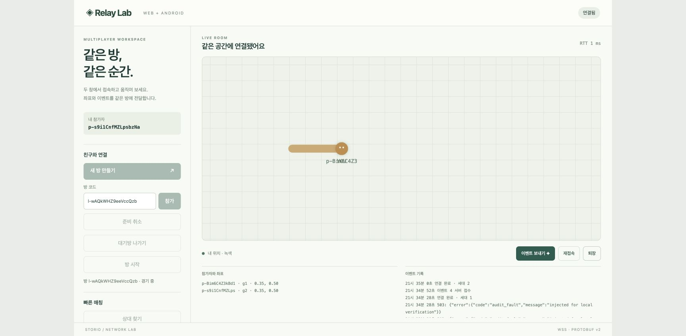
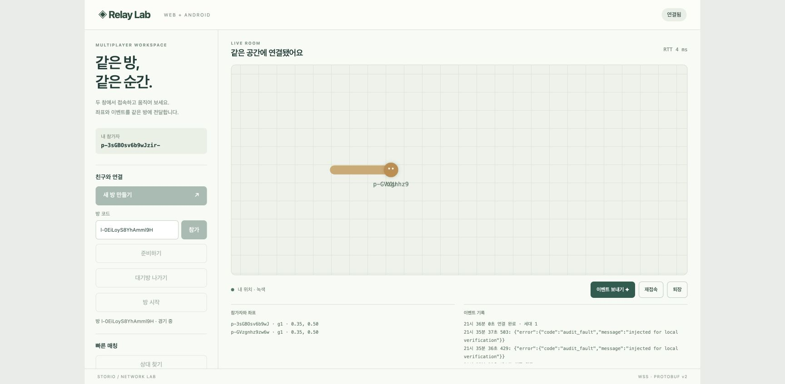
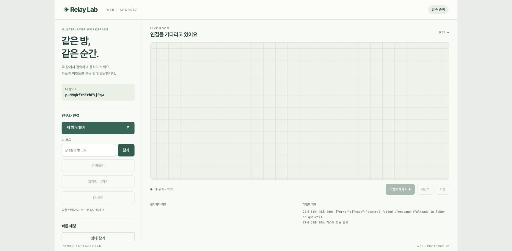
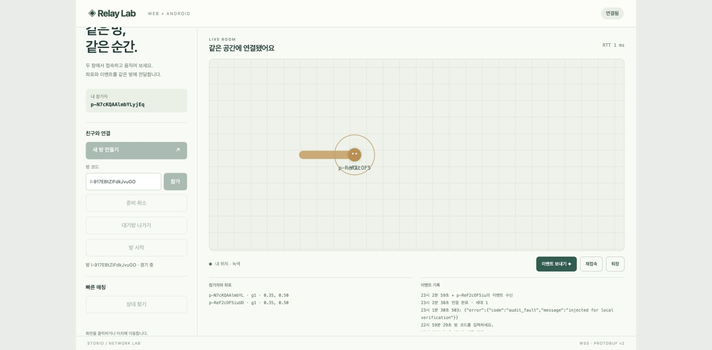

# v2 전용 구조 변경 증거

2026-10-23 기준으로 Task 1-9의 구현·검사·개별 리뷰를 마쳤다. Task 10 문서와 로컬 검사는 완료했다.
Task 10 독립 리뷰와 전체 브랜치 리뷰를 마쳤다. 유일한 I1은 `d182e70` 수정 후 재리뷰에서 닫았다.
이 구조 변경은 완료했다. 전체 제품 완료를 주장하지 않는다.
실제 Linux·원격 CI·Android 실기기·무선 망·전체 부하는 이번 작업에서 실행하지 않았다.

## 소스와 검사 연결

첫 문서 작업의 기준 커밋은 `dd91f5bc8db433457dea87844c419e179741da05`다. 최종 제품 수정은 `d182e70e1fc1ec94d6a1417b53ad99febd32dc15`다.
브랜치는 `codex/wss-v2`다. 이번 종료 작업은 문서·상태·증거만 바꾼다.
Task 10은 Go·SDK·스크립트·설정·CI를 바꾸지 않았다. 같은 입력의 통과 검사를 반복하지 않았다.
기존 실행의 명령·출력·종료 상태를 읽고 당시 소스의 SHA-256과 대조했다. 최종 main.ts 수정은 별도 근거로 연결한다.

- Go 실행 구조: `e98029242cb2f7a6e661041ae80e96fae6f7504f`.
- SDK 수명주기: `f2f61c0be086d3b3a6566744ceda0840051895af`.
- 데모 조회 복구와 Chrome: `4b98e3c1c57db08d59e661cd424e11203f1084d8`.
- protocol·생성·CI 도구: `fe916749614969176efe65f23dd04e7ea551d04f`.
- 운영 경로와 검토 수정: `c887ca2ae5251e350d13695b0257b7d0a3c8cf41`·`dd91f5bc8db433457dea87844c419e179741da05`.
- 최종 I1 수정·production 핸들러 검사: `d182e70e1fc1ec94d6a1417b53ad99febd32dc15`.

[원래 소스 연결 JSON](2026-10-23-structure-refactor/source-bindings.json)은 dd91 시점에 확인한 해시다. 이 파일을 새 main.ts에 재연결하지 않았다.
원래 집합은 Go 47개·실제 프로세스 62개·Task 8 입력 129개·운영 70개다.
Task 8의 문서·이전 운영 파일은 이후 작업에서 바뀌었다. 239개 전체의 무조건 일치를 요구하지 않았다.
선택한 129개는 Go·모듈·SDK·생성·빌드·protocol 도구 입력이다. 첫 Task 10 검사 당시에는 모두 같았다.
최종 수정 후 Go 47개·운영 70개·Task 5 backend Go 46개는 모두 같다.
process 집합은 61개, Task 8 집합은 128개가 같다. 두 집합의 차이는 `client/src/demo/main.ts` 하나다.
원래 manifest가 모든 client TS를 넓게 포함했다. 실제 process checker는 SDK를 import하며 데모 main.ts를 사용하지 않는다.
SDK·checker·Go·protocol 입력은 그대로다. 새 main.ts에는 31개 핸들러 검사·TS 빌드·실제 Chrome 증거를 적용했다.
최종 CI YAML은 Task 9에서 삭제한 setup 호출만 제거했다. 최종 YAML 파싱은 exit 0이며 Makefile은 그대로다.

Chrome 입력 9개도 첫 문서 검사 당시에는 같았다. 최종 수정 후에는 8개가 같고 main.ts 하나가 바뀌었다.
Chrome 이후 `client/package.json` 변경은 생성 명령과 알려진 Node 경고 억제뿐이다. JSON에 실제 diff를 보존했다.
Chrome 당시 바이너리는 이후 다시 빌드했다. VCS 메타데이터 때문에 바이너리 해시가 다르며 당시 해시와 같은 Go 소스 해시를 구분했다.

검사 환경은 Darwin arm64, Go 1.26.10, Node v24.3.0, npm 11.11.0이다.
Go 검사는 `GOTOOLCHAIN=local`과 저장소의 `.cache/go-build`·`.cache/go-mod`를 사용했다.
기록한 출력은 [verification.log](2026-10-23-structure-refactor/verification.log)에 있다. 원본 로그의 SHA-256도 연결 JSON에 남겼다.
도구 회귀 로그는 PASS·종료 상태를 발췌했다. package graph는 저장소 package와 종료 상태를 발췌했다.
나머지 선택 로그와 두 Chrome 접근성 기록은 원문을 보존했다.

## 실행한 검사

아래 표는 원래 실행을 기록한다. 새 main.ts의 결과는 최종 I1 절에 별도로 적었다.

| 검사 | 실제 명령 또는 대상 | 결과와 범위 |
|---|---|---|
| Go 전체 경합 | `.tools/go/bin/go test -race ./...` | exit 0. 같은 소스의 유효한 Go cache 포함 |
| Go 정적 검사 | `.tools/go/bin/go vet ./...` | exit 0 |
| Go 포맷 | `test -z "$(.tools/go/bin/gofmt -l cmd internal gen/go)"` | exit 0 |
| Go 취약점 | `.tools/go/bin/go run golang.org/x/vuln/cmd/govulncheck@v1.8.0 ./...` | `No vulnerabilities found.`·exit 0. 보안 인증을 뜻하지 않음 |
| package graph | `.tools/go/bin/go list -deps ./...` | exit 0. 제거한 서버·package·생성 import 없음 |
| 고정 도구·생성 | `make tools`, `npm run proto --prefix client` | exit 0. 기존 Darwin 도구 재사용, 새 다운로드 아님 |
| protocol gate | `make protocol-check` | lint·고정 baseline breaking·Go·TS 생성 차이·protocol·relay 검사 exit 0 |
| 도구 회귀 | `python3 scripts/check-protocol-tools.py` | 오래된 Go·TS·schema-only 차이 거부, 생성 실패 후 출력 보존, 복원 통과 |
| TS 빌드 | `npm run build --prefix client` | 타입 검사·Vite 빌드 exit 0 |
| SDK 수명주기 | `npm run check:lifecycle --prefix client` | 이전 갱신 성공·실패·finally 격리, 실제 HTTP 200·503 본문 정지의 5초 제한 통과 |
| wire | `node --disable-warning=ExperimentalWarning --experimental-transform-types client/scripts/check-wire.ts` | 17종 Go→TS→Go·uint64 최댓값 통과, exit 0 |
| 실제 SDK | `npm run check --prefix client -- http://127.0.0.1:18098` | 실제 두 소켓·상태 병합·사건·재접속·재발급·suspend/resume 통과, exit 0 |
| 실제 분산·Snake | 아래 실제 프로세스 절 | cluster 6개·Snake 권한 검사 exit 0 |
| 운영 배포 | `python3 -u infrastructure/scripts/tests/deploy-backend.py` | 임시 호스트의 트랜잭션 79개와 실제 상태 검사 스크립트 통과, exit 0 |
| 토큰·비용 | `python3 -u infrastructure/scripts/tests/operator-token.py`, `python3 -u infrastructure/scripts/tests/traffic-budget.py` | canonical 토큰·교체 거부·장부·영구 차단·초기화 검사 exit 0 |
| 셸 | `bash -n` 운영 배포·패키징·상태 스크립트, `sh -n` 비용 wrapper | exit 0 |
| Linux 패키지 | `bash infrastructure/scripts/package-release.sh OUTPUT.tar.gz` | Linux amd64 ELF64·17개 항목·14개 파일 체크섬 확인. 기존 출력 거부는 기대한 exit 2 |

v2 baseline은 Task 2의 `d20bd3d20ae5199d0bddccc932c72e40f63785cd`에서 고정했다.
SHA-256은 `1f71ed2a0295a50dfc9c2b5cbc19dfdda96e54d738552fa9bf6d562a94b4259e`다.
검사 때문에 baseline을 새 스키마로 덮어쓰지 않았다. 생성 실패는 Go·TS 출력과 baseline을 보존했다.

운영 검토에서 선택 `caFile` 타입·숫자 진법·원시 URL 입력 오류 세 건을 발견했다.
기존 배포가 잘못 승격하는 실패를 각각 재현했다. `dd91f5b`에서 공통 입력 검사를 고치고 79개 시나리오를 통과했다.
재리뷰는 세 건을 모두 닫았고 새 Critical·Important 발견사항은 없었다. 이전 50·51개 결과를 최종 수치로 사용하지 않는다.
새 거부 사례는 current·유닛·Caddy·가드·토큰·CA·nodes·초당 예산·장부 바이트와 서비스 호출 부재를 확인했다.
패키지 SHA-256은 `acc7757de104542580108a9f352fdd94cea03cc0e0da479888537ca681de1c9f`다.
이 값은 로컬 검증 archive의 식별자다. 검증 archive와 비밀 파일을 문서 자산으로 복사하지 않았다.

## 실제 HTTPS·WSS 프로세스

기존 `client/scripts/check-cluster.ts`와 `check-snake.ts`를 실행했다. 원래 검사 로직·SDK·소켓을 사용했다.
임시 사본은 fixture 경로와 결과 목적지만 바꿨다. 기존 2026-10-22 JSON은 덮어쓰지 않았다.
실제 명령·종료 상태는 verification.log에, 실제 결과는 [프로세스 JSON](2026-10-23-structure-refactor/process-results.json)에 보존했다.

별도 `dev-tls` 명령으로 새 로컬 CA를 만들고 `NODE_EXTRA_CA_CERTS`에 지정했다. HTTPS·WSS 인증서 검증은 유지했다.
cluster는 방 단일 소유·격리, 드레이닝 중 복귀, 배정기 재시작, 노드 장애·재시작, 증설, 마지막 방 이후 종료를 확인했다.
Snake는 전체 몸통 수신·소유자의 늦은 최초 접속·비권한자 공용 상태 거부·일시 복귀·종료 상태·영구 이탈을 확인했다.
16명 최대 몸통 스냅샷은 18,507바이트로 128 KiB 아래였다. 이는 메시지 크기 검사이며 새 부하 성능 측정이 아니다.

cluster는 시험용 9611-9614·9640-9643 포트를 사용했다. Snake 공개 포트는 58566이며 관리 포트는 58567이었다.
실행기는 자기 클라이언트·자식 프로세스만 정리했다. Snake 자식의 `REAPED_EXIT_STATUS=0`을 기록했다.
임시 토큰·개인 키·스크립트 사본은 제거했다. 공개 인증서와 실행기 해시는 연결 JSON에 남겼다.
첫 fixture 준비는 Python `Path.open(opener=...)` 오류로 서버 시작 전에 실패했다. 이를 제품 RED로 계산하지 않았다.

같은 검사를 재현할 때는 [README 검사 명령](../../../README.md#검증)으로 바이너리를 빌드한다.
새 CA와 비공개 시험 토큰을 사용한다. 기존 증거 JSON의 목적지는 별도 임시 경로로 바꾼 뒤 checker를 실행한다.
토큰·개인 키를 출력하거나 저장소에 넣지 않는다. 사용한 프로세스와 임시 파일을 검사 뒤 정리한다.

## 실제 Chrome

연결한 Chrome `browser1`의 시험용 탭 `1490580632`·`1490580634`를 사용했다. URL은 `http://127.0.0.1:38173/`였다.
접근성·입력·새로고침·스크린샷 API로 두 참가자를 조작했다. Vite는 proxy 38190의 제어 API를 사용했다.
proxy는 실제 Go 서버 38191로 요청을 전달했다. WSS 배정은 실제 backend의 WS 주소를 반환했다.
이 브라우저 검사는 로컬 HTTP·WS다. HTTPS·WSS 증거는 앞의 별도 프로세스 검사다.

- 로비·티켓 조회의 `429 → 503 → 200`과 assignment·owner 조회의 `503 → 200` 뒤 복구했다.
- 로비에서 두 참가자가 준비·시작했다. 상대 사건 수신과 재접속 generation 2를 화면에서 확인했다.
- FIFO에서도 두 참가자가 같은 방에 연결했다. 먼저 연결한 상대 때문에 경기가 끝나지 않았다.
- 로비·티켓 `403`·`404`·`410`은 조회를 멈추고 입장 제어를 복원했다.
- 퇴장·취소 `409`·`503`은 같은 소속을 유지하며 조회를 재개했다.
- 성공한 퇴장·취소와 pagehide 뒤 이전 실패 조회가 새 화면·연결·타이머를 되살리지 않았다.

[원래 브라우저 trace JSON 11개](2026-10-23-structure-refactor/browser-traces.json)를 한 파일에 모았다.
verification.log의 실제 접근성 기록은 두 화면의 참가자·세대·사건을 보존한다.
proxy의 오류 주입은 브라우저 오류 정책을 확인한다. 실제 서버의 권한·만료는 별도 Go 검사로 확인했다.

held-response 검사에서는 5초 요청 제한이 퇴장·취소 클릭 전에 끝났다. 실제 Chrome은 오래된 실패 조회의 무효화만 입증한다.
퇴장 후 이전 성공 조회 응답을 실제 Chrome DOM이 소비한 경우는 입증하지 못했다. SDK deferred 성공 검사는 SDK 갱신 경로를 확인한다.
리뷰어는 데모의 성공 guard를 코드로 확인했다. 새 production 핸들러 검사는 stale query 성공·실패를 확인한다.
이 경계 대체 검사와 SDK 검사를 실제 Chrome DOM 검사로 표시하지 않는다.
첫 4초 hold·잘못된 200 기대·pagehide 경계 선택은 fixture·검사 오류였다. 수정한 기록만 위 결과에 포함한다.
시험용 backend·proxy·Vite를 종료하고 토큰을 제거했다. 기존 사용자 5173 프로세스는 건드리지 않았다.

## 최종 I1 수정과 리뷰

[원래 전체 브랜치 리뷰](2026-10-23-structure-refactor/final-review.md)는 `ba3db51`부터 `790fec4`까지 확인했다.
판정은 `With fixes — 0 Critical, 1 Important, 0 Minor`였다. 이 원문을 깨끗한 판정으로 고쳐 쓰지 않았다.
I1은 겹친 진입 요청이 먼저 성공한 서버 소속을 버리는 오류였다. create·join·match가 같은 진입 경계를 사용하도록 수정했다.
`d182e70`은 `main.ts`와 `check-demo-entry.mjs`만 바꿨다. 새 의존성·SDK·서버 API는 추가하지 않았다.
[재리뷰 원문](2026-10-23-structure-refactor/final-rereview.md)은 I1을 `ADDRESSED`로 판정했다. 새 Critical·Important·Minor 발견사항은 없었다.
Task 10 독립 리뷰도 승인했다. 로그 헤더의 발췌 표시 한 건은 `790fec4`에서 고쳤다.

실제 명령은 `node --disable-warning=ExperimentalWarning --experimental-transform-types client/scripts/check-demo-entry.mjs`다. 저장소 루트에서 실행했다.
최초 RED는 동기 진입 차단 assertion에서 exit 1이었다. 첫 GREEN 시도는 퇴장 후 비운 방 코드를 fixture가 채우지 않아 실패했다.
fixture만 고친 최종 검사는 31개 시나리오와 exit 0을 기록했다. 최종 `npm run build`도 exit 0이었다.
검사는 실제 production 핸들러·상태·조회·pagehide 블록을 추출해 실행한다. API·DOM·타이머 경계는 대체한다.
9개 진입 조합·실패 후 재시도·폐기 후 결과·이전 조회 성공과 실패·퇴장·취소·pagehide를 확인했다.
새 명령은 [README 검사 절](../../../README.md#검증)에도 적었다. 문서 종료 작업에서는 기능 검사를 반복하지 않았다.

실제 Chrome은 같은 proxy의 첫 성공 응답을 3초 유지했다. 기존 5초 요청 제한 안에서 성공 응답을 받았다.
RED는 두 create 요청의 `409, 201` 뒤 로비 조회가 없고 퇴장도 불가능했다.
GREEN은 double-create의 단일 201·조회·퇴장, double-join의 단일 200·두 참가자 소속을 확인했다.
create·queue의 503 뒤 재시도와 취소도 확인했다. 새 코드의 두 Chrome 참가자가 중계 방에 연결하고 사건을 교환했다.
이 Chrome 관찰은 로컬 HTTP·WS다. 브라우저 화면의 성공한 진입 mutation은 퇴장 후 성공한 이전 query의 DOM 검증과 다르다.
해당 query 제한은 그대로 남긴다. 시험용 탭·포트·프로세스·토큰을 정리했고 기존 사용자 5173은 건드리지 않았다.

[수정 실행 로그](2026-10-23-structure-refactor/entry-fix.log)는 RED·fixture 실패·31개 GREEN·빌드·Chrome assertion·정리 상태를 보존한다.
[수정 소스 연결](2026-10-23-structure-refactor/entry-fix-bindings.json)은 새 소스·런타임·원래 파일명·해시와 역사 집합 비교를 보존한다.
[브라우저 JSON](2026-10-23-structure-refactor/entry-fix-browser.json)은 원래 trace와 접근성 기록을 묶었다. 토큰·개인 키는 포함하지 않았다.
기존 `source-bindings.json`·`verification.log`와 원래 화면·프로세스 결과는 당시 기록으로 유지한다.

## 승인 판정 네 건

실행 장부에서 `Ruling:`으로 시작하는 줄 네 개를 모두 옮겼다. 판단·이유·틀렸을 때 비용을 보존한다.

1. 최신 구현 승인이 이전 계획 전용 상태보다 우선한다. 최신 사용자 지시가 명시한 범위이기 때문이다.
   해석이 틀리면 로컬 커밋을 되돌려야 한다. 원격 부작용은 승인하지 않았다.
2. 기존 `codex/wss-v2` 작업 공간에서 집중한 로컬 커밋을 만든다. 이 브랜치 작업 방식을 설명했고 사용자가 승인했다.
   별도 체크아웃보다 격리가 약하다. 다른 변경을 건드리면 작업이 섞이므로 기존 사용자 변경을 보존한다.
3. v1 전용 playerauth 임의 키 옵션 제거를 Task 5에 배정한다. 승인 설계가 제거를 요구하며 모든 제품 호출자는 `StableKey:true`를 사용했다.
   판단이 틀리면 내부 선택 모드를 복원해야 한다. 활성 v2 토큰 바이트는 바꾸지 않는다.
   Task 2의 경로·삭제 범위와 분리한 후속 작업이며 Task 5에서 완료했다. 고정 토큰 fixture도 유지했다.
4. 장부 보존은 배포·롤백에서 회계를 초기화·삭제하거나 과거 값으로 되돌리지 않는다는 뜻이다. 정상 NIC 표본은 기록한 사용량을 늘릴 수 있다.
   승인 설계는 durable 회계를 요구한다. 앞선 dispatch의 바이트 불변 조건은 이를 과도하게 제한했다.
   문자 그대로 불변이 의도였다면 배포 기대와 검사를 바꿔야 한다. 표본 보존은 측정한 사용량의 유실을 막는다.
   live 토큰·CA·nodes·초당 예산은 바이트를 보존한다. 설정 검사가 reconciliation 전에 실패하면 장부도 그대로 둔다.

## 현재 문서와 검사

현재 구조는 [TRD](../../TRD.md), 제어 계약은 [HTTP 명세](../../specs/2026-10-22-control-v2-http.md)를 따른다.
`cmd`는 얇은 명령이고 `app`이 실행을 조립한다. `control.Manager`는 상태를, HTTP Server는 입력·응답을 소유한다.
`coordinator`·`relay`·`httpx`·`protocol`·`operatortoken`은 기능별 책임을 갖는다. 새 Manager·저장소 인터페이스를 추가하지 않았다.
운영 경로는 [flat infrastructure](../../../infrastructure/README.md) 하나다. v1 전용 문서 24개를 제거했다.
승인 당시 이동·삭제 행렬과 날짜가 있는 WSS 실행·부하 기록은 보존했다. Git 이력을 수정하거나 legacy 트리를 만들지 않았다.
활성 `tokenVersion=1`·`player-token/v1`·`snake-demo.v1`·`demo.v1`·`load.v1`은 제거 대상이 아니다.
비용 가드의 `/var/lib/lobby-relay` 확인은 이전 장부가 있을 때 초기화를 거부한다. 이 보호 조건은 이전 서버 실행 경로가 아니다.

Task 10은 로컬 Markdown 링크, 현재 실행·빌드·CI·운영의 폐기 경로, 삭제 파일 집합과 공백을 검사했다.
[문서 검사 로그](2026-10-23-structure-refactor/document-checks.log)에 첫 문서 검사와 종료 검사의 명령·출력·종료 상태를 보존한다.
코드 블록·외부 URL·anchor는 링크 검사에서 제외했다. 역사 문서의 옛 소스 경로와 활성 식별자는 허용했다.

## 미실행 조건

실제 Linux의 systemd·Caddy·공개 DNS·TLS·방화벽·원격 노드 연결은 확인하지 않았다.
임시 호스트 명령 대체와 Linux ELF 확인은 실제 서비스 기동 증거가 아니다. Docker daemon 정보 조회도 Linux 앱 검증이 아니다.
Linux bootstrap·새 도구 다운로드·원격 CI도 실행하지 않았다. CI 정의와 로컬 검사를 원격 성공으로 바꾸지 않는다.
Android 실기기·화면 잠금·Wi-Fi·이동통신 전환·저속 장치·무선 손실은 미검증이다.
2026-10-22 [부하 측정](load/README.md)은 당시 장비·본문·정원·주기만 설명한다. 전체 부하를 이번에 다시 실행하지 않았다.
구조 변경의 리뷰는 완료했다. 원래 제품 완료 조건은 [완료 감사](completion-audit.md)에서 계속 추적한다.
실제 기기·망·운영 호스트 조건이 준비되면 남은 제품 검증을 실행한다.
